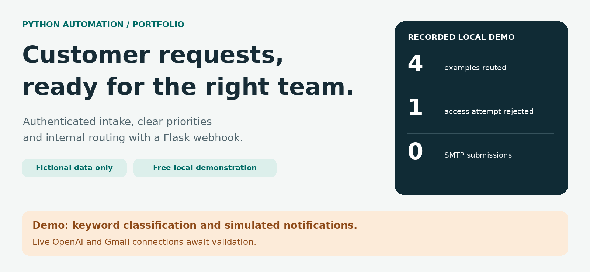
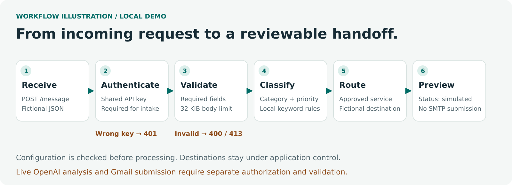
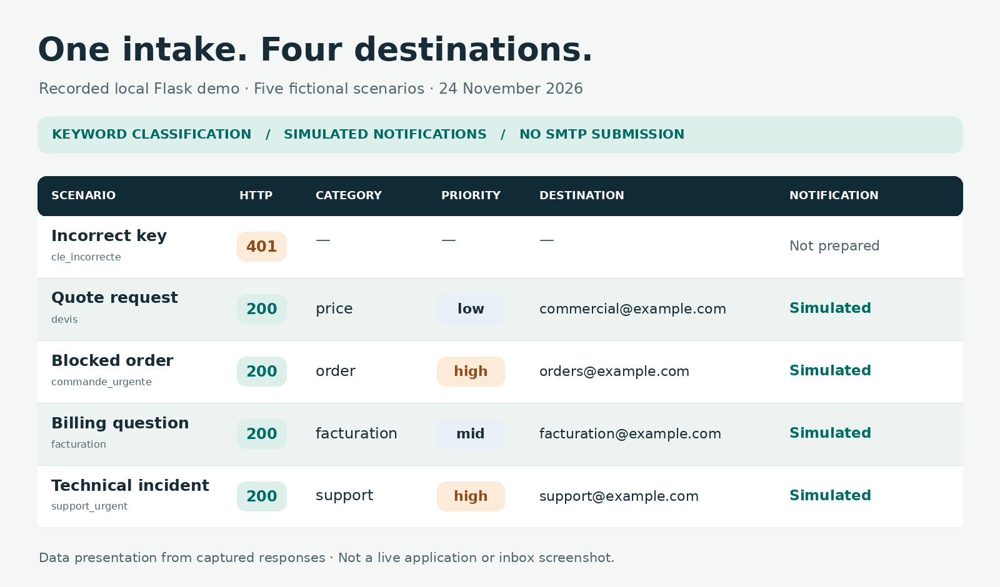
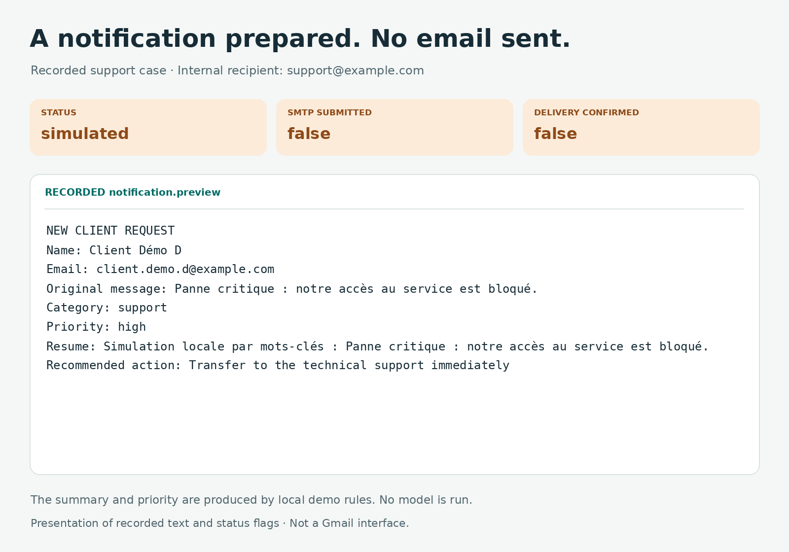

# Customer Message Automation

### Validated intake. Clear priorities. Consistent internal routing.

A Python and Flask project that turns incoming customer requests into structured,
reviewable work for sales, order management, billing and support teams.

**This is a public portfolio showcase.** The application and internal tests remain
private. The examples are fictional. Demo classification uses local keyword rules;
notifications are simulated. **Live OpenAI and Gmail integrations are not yet validated.**

[Explore the demo](DEMO_WALKTHROUGH.md) · [Review validation](VALIDATION.md) ·
[Discuss an automation project](https://github.com/kw5ytftdky-cloud)

## The business problem

A shared inbox or contact form can mix pricing questions, delivery issues,
billing queries and technical incidents. Someone must read each message,
decide what matters and find the right internal team.

This project demonstrates a controlled intake workflow that prepares that work:
authenticate the request, validate its contents, assign a category and priority,
then select an internal destination and prepare a notification.

For a business, the intended benefits are more consistent handoffs, less repetitive
triage and clearer handling of urgent requests. Actual time savings and classification
quality must be measured on an authorized, representative dataset.

## What the workflow does

| Capability | Business purpose | Current evidence |
| --- | --- | --- |
| Receive customer messages through `POST /message` | Connect a form or upstream system to a structured intake process | Local Flask request handling verified |
| Authenticate with `X-API-Key` | Reject requests without the expected shared key | Unauthorized cases covered in local tests |
| Validate JSON and field limits | Stop malformed or oversized inputs before analysis | Required fields, types and a 32 KiB request limit tested |
| Classify requests into four departments | Prepare a repeatable internal handoff | Keyword-based demo reproduced; live OpenAI quality unvalidated |
| Assign `low`, `mid` or `high` priority | Surface urgency for the receiving team | Local demo and business rules tested |
| Choose an approved destination | Keep routing under application configuration | Four routes demonstrated with fictional addresses |
| Prepare an internal notification | Give the team the message, summary and recommended action | Preview verified; no real email sent in the demo |
| Handle configuration and provider failures | Return an explicit failure instead of a false success | Failure paths tested with mocks |

An action is a recommendation. The application does not change an order,
reply automatically to the customer or perform arbitrary instructions from a message.

## Workflow at a glance

*Simplified workflow illustration, not an application screenshot. Classification
in this demo is a local simulation; the live provider connections await validation.*

## Recorded demonstration

| Fictional case | HTTP result | Category | Priority | Internal destination | Notification |
| --- | --- | --- | --- | --- | --- |
| Incorrect access key | `401` | Not analyzed | — | None | None |
| Quote request | `200` | `price` | `low` | `commercial@example.com` | Simulated |
| Blocked order | `200` | `order` | `high` | `orders@example.com` | Simulated |
| Billing question | `200` | `facturation` | `mid` | `facturation@example.com` | Simulated |
| Technical incident | `200` | `support` | `high` | `support@example.com` | Simulated |

`facturation` is the application's category identifier for billing. The original
requests are in French; the case labels above are English descriptions.
All `example.com` addresses are fictional and are never contacted in the demo.

The [fictional requests](demo/fictional-messages.json) and
[recorded responses](demo/recorded-results.json) are available for inspection.
A successful HTTP response here means the **demo workflow** completed, not that
OpenAI ran or an email was delivered.

### Notification preview — not sent

The response explicitly records `mode: demo`, `analysis_source: local_rules_demo`,
`notification.status: simulated` and `smtp_submitted: false`.
The preview is text prepared by the application, not a Gmail inbox screenshot.

## Validation results

| Scope | Result | Basis |
| --- | --- | --- |
| Private application's local tests on Windows | **42 passed** | Confirmed by the project owner; not rerun on Windows in this preparation |
| Private application's tests rerun on Linux | **42 passed** | Independently rerun during showcase preparation on 24 November 2026 |
| Free local demo | **5 recorded responses** | Reproduced: one `401` and four `200` responses |
| OpenAI live integration | **Not validated** | Provider calls replaced by mocks in tests; no model runs in the demo |
| Gmail / SMTP live integration | **Not validated** | SMTP replaced by mocks; no external message submitted |

Tests cover authentication, malformed inputs, priorities, routing, configuration,
invalid model responses and simulated provider failures. They do not establish
live classification accuracy, inbox delivery or production readiness.
Details and evidence boundaries are in [VALIDATION.md](VALIDATION.md).

## Technology

- **Python 3.10+** for request processing and automation logic.
- **Flask, HTTP and JSON** for the webhook interface and local request tests.
- **OpenAI Python SDK** for the private application's optional live analysis path;
  that integration remains unvalidated.
- **SMTP over TLS / Gmail** for the optional live notification path; unvalidated.
- **python-dotenv** for private configuration loading.
- **unittest and mocks** for repeatable, free local verification.

This showcase contains documentation, rendered visuals and fictional JSON only.
It is not an installable copy of the private application, a hosted service or a live dashboard.

## Current boundaries

- The demo uses simple keyword rules. Ambiguous messages can be classified incorrectly;
  the demo is not an assessment of OpenAI's accuracy.
- Real OpenAI access, model compatibility, Gmail authentication and delivery still
  need separately authorized integration tests. Live analysis may incur API costs.
- Shared-key authentication is implemented; rate limiting, idempotency, durable
  storage and background processing are not implemented.
- Processing is synchronous. Repeated requests can cause repeated API costs or
  notifications in live mode; an SMTP timeout can leave submission uncertain.
- Local Flask tests do not prove public-network availability. No production
  deployment or HTTPS service is demonstrated here.
- Before client use: verify provider integrations, measure results against a human
  reference, define privacy and retention rules, and agree on monitoring and recovery.

**Current status: validated local workflow and simulated demonstration; live
provider integrations and production operation remain to be validated.**

## Freelance engagements this work can support

Potential projects include webhook intake for customer forms, custom department
routing, priority rules, notification templates and local test suites for existing
automations. Live AI or email integration can be scoped after requirements,
authorization and acceptance criteria are agreed.

See [FREELANCE_SERVICES.md](FREELANCE_SERVICES.md) for a practical engagement outline.
No response-time, accuracy or savings guarantee is implied by this portfolio example.

## Availability and related work

The full implementation and internal tests are maintained privately. A walkthrough
can be discussed without distributing the private code or using client data.

- **Project enquiries / profile:** [kw5ytftdky-cloud](https://github.com/kw5ytftdky-cloud)
- **Related portfolio:** [PDF invoice automation](https://github.com/kw5ytftdky-cloud/invoice-automation-portfolio)

*Python automation portfolio · Fictional demonstration data only.*
